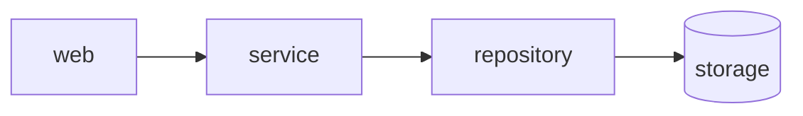

# easement

Architecture quality gate for polyglot codebases.

Declare the components of your system and which of them may depend on which. `easement` extracts the real dependencies from the code, builds the graph and fails the build when the code drifts from the declared architecture.

> **easement** — a legal right to cross someone else's land. In `easement`, every allowed dependency between components is an explicit easement; everything else is trespassing.

## Install

`easement` runs a SCIP indexer for each indexed language it finds, so install those too, see [Indexers](#indexers).

```sh
brew install mokevnin/tap/easement
```

Homebrew works on macOS and Linux. Other options:

- the install script for macOS and Linux, which checks the archive against the checksums of the release and installs to `/usr/local/bin`:

  ```sh
  curl -fsSL https://raw.githubusercontent.com/mokevnin/easement/main/install.sh | sh
  ```

  Pass `-b <dir>` to install elsewhere and `-v <version>` to pin a release: `... | sh -s -- -b ~/.local/bin -v 0.1.0`;
- `.deb` and `.rpm` packages for amd64 and arm64 on each [GitHub release](https://github.com/mokevnin/easement/releases): `sudo apt install ./easement_<version>-1_amd64.deb` or `sudo dnf install ./easement-<version>-1.x86_64.rpm`;
- `cargo install easement`;
- prebuilt binaries for macOS, Linux and Windows, with a PowerShell installer for Windows, on each release.

Windows binaries are built, but Windows is not tested and its support is not guaranteed: some indexers do not work there.

## Set up with a coding agent

Copy this prompt into Claude Code, Codex, Cursor or another coding agent opened in your project. The agent installs `easement`, the indexers and the [agent skill](#agent-skill), writes `easement.yml` for the architecture it finds, wires the check into CI and points the project's agent instructions at the skill.

```text
Set up easement (https://github.com/mokevnin/easement), an architecture quality gate, in this project. Read its README first; it is the reference for every step below.

1. Install easement the way this project installs its tools: a line in mise.toml if the project uses mise ("github:mokevnin/easement" = "latest"), otherwise Homebrew or the install script from the README.
2. Run `easement doctor --format json` and install every indexer it reports missing, again the way the project installs tools. Repeat until it exits 0.
3. Run `easement init`, then `easement check`. If the report says files are not covered by an indexer, fix the cause (a tsconfig include, a missing go.mod) or list them in `uncovered_ok` with a reason.
4. Study the code and turn the generated config into the intended architecture: remove the allowances that should not exist, give every rule a `because` that tells where the code should go instead, and use `layers`, `public`, `no_cycles` and `tests: auto` where they fit. Do not change application code to make the check pass. When the config is final, record the existing violations with `easement baseline`.
5. Add the check to CI: the GitHub Action from the README with `diff` on pull requests if the project uses GitHub Actions, otherwise `easement check` in the existing pipeline. If the project has git hooks, run it on pre-push.
6. Install the easement skill into the project with `npx skills add mokevnin/easement`, for the agents this team uses, and commit the files it writes, so every agent that works here gets it.
7. Add these rules to the project's agent instructions (AGENTS.md, CLAUDE.md or whatever file the project already uses; create AGENTS.md if there is none):
   - Use the easement skill before adding a file or an import and whenever `easement check` fails.
   - After changing code, run `easement check`; it must exit 0.
   - Never edit easement.yml, regenerate the baseline or add an `easement:disable` comment without asking a human.
8. Run `easement check` once more and report: the components and rules you chose and why, the number of baselined violations, and anything you were unsure about.
```

Review the rules it proposes: an agent sees the code as it is, and only you know which of today's dependencies are mistakes.

### Agent skill

[`skills/easement/SKILL.md`](skills/easement/SKILL.md) teaches an agent the daily work with easement: `explain` before adding code, `check` after it, fixing a violation by its `because` instead of editing the config, shrinking the baseline, and changing `easement.yml` when a human agrees. It follows the [Agent Skills](https://agentskills.io) format, so Claude Code, Codex, Cursor and others read it. The skill comes from this repository and changes with easement, while rules copied into a project's AGENTS.md go stale.

Install it into a project with the [skills](https://github.com/vercel-labs/skills) CLI (add `-g` for every project on the machine):

```sh
npx skills add mokevnin/easement
```

In Claude Code it is also a plugin:

```text
/plugin marketplace add mokevnin/easement
/plugin install easement@easement
```

## Status

Go, TypeScript/JavaScript, Python, Rust, PHP, Java, C# and Ruby are resolved by [SCIP](https://scip-code.org/) indexers, so they need the [indexers](#indexers) installed; Kotlin and Swift are read with tree-sitter.

## Usage

Start from the code as it is: `easement init` finds the components in the layout of the project and allows every dependency it sees between them.

```text
$ easement init
easement: wrote easement.yml with 4 components and 5 allowed dependencies; remove the dependencies that should not exist, then run `easement check`
```

```yaml
rules:
  handlers: { may_depend_on: [repository, services] }
  repository: { may_depend_on: [models] }
  services: { may_depend_on: [models, repository] }
```

Then say what the architecture should be. Handlers should not reach the storage directly, so drop `repository` from their allowances and give the reason:

```yaml
  handlers:
    may_depend_on: [services]
    because: handlers go through services, never straight to storage
```

`easement check` now points at the code that breaks the rule, like any linter:

```text
$ easement check
internal/handlers/books.go:6: handlers -> repository is not allowed (imports internal/repository/books.go) [dependency]
  because: handlers go through services, never straight to storage

easement failed: 1 violation(s), 0 stale, 0 legalized; 5 files, 6 internal deps, 1 files outside components
```

It exits 0 when the code matches the config, 1 on violations and 2 on an error (a broken config, a missing indexer). Fix the import (or, if it is right, the rule) and run it again.

The commands you will use most:

```sh
easement init                 # write a starting easement.yml
easement check                # check the project
easement check --diff main    # only what this branch adds, see Diff mode
easement baseline             # record today's violations; later runs only shrink it
easement explain <file>       # which component a file is in and what it may do
easement why <a> <b>          # the imports, or the chain, behind a -> b
easement impact --diff main   # every file that depends on what this branch changed
easement suggest              # allowances nothing uses, imports nothing allows
easement doctor               # are the indexers the project needs installed
```

`easement --help` and `easement <command> --help` list the rest: the report formats for CI, `graph`, `schema`, `--watch`, the cache flags, shell completions (`easement completions zsh > ~/.zfunc/_easement`). The text report is coloured on a terminal; `--color auto|always|never` overrides that, and `auto` honours `NO_COLOR` and `CLICOLOR_FORCE`.

### init

`easement init` finds the components in the layout of the project (the subdirectories of `internal/`, `src/`, `app/`, … or the top-level directories) and allows every dependency it finds between them. The first `easement check` passes; remove the dependencies that should not exist, and add `because:` reasons.

### suggest

`easement suggest` reads the real graph against the config and lists:

- the `may_depend_on` entries no import uses;
- the imports that nothing allows;
- the components whose instances never import each other and so could be `isolated` (only `*` patterns, never `**`).

An entry next to files no indexer covered is listed apart as unreliable, because the import it would remove may be in a file that was never read. Check those by hand before removing anything.

- `--patch` prints the removals as a patch: `easement suggest --patch | git apply`. It edits the text of `easement.yml`, so comments and `because` reasons stay, and it never touches an entry next to unindexed files. An entry it cannot place (a rule that comes from `extends` or an alias, a list written over several lines) is named on stderr to remove by hand.
- `--check` prints the same report and exits 1 while an unused entry is left that `--patch` would remove, so a CI step keeps the allowances from piling up.

### impact and why

`easement impact <paths>` lists every file that depends on the given files or directories, directly or through others, grouped by component: what a change can break and which tests to run. `--diff <base>` adds the files changed since the merge-base, and `--format json` gives `changed` and `dependents`. When files were not covered by an indexer, `confidence` is `partial`, because dependents through them are missing.

`easement why <a> <b>` says whether the config allows `a -> b` and why, then lists the imports behind it with file and line, or, when there is none, the shortest chain of imports from `a` to `b`.

`easement graph --focus <component>` draws only that component and the ones it shares an arrow with.

### doctor

`easement doctor` looks at the languages the project has and says, for each, whether its indexer is on the `PATH`, which version, and whether what it needs is in place (`node_modules` for TypeScript, `composer install` for PHP). For a missing indexer it prints how to install it and, where mise can, the lines for the `[tools]` of a `mise.toml`.

It exits 1 when something is missing, so a script or an agent can run it first and read `--format json`.

### easement.yml

`easement.yml` lives in the project root; all paths are relative to it.

```yaml
version: 1

components:
  handler:    { in: internal/handlers }
  service:    { in: "internal/services/**" }
  repository: { in: "internal/domain/*/repository" }
  model:      { in: internal/models }

common: [model]

rules:
  handler: { may_depend_on: [service] }
  service:
    may_depend_on: [repository]
    because: services never talk HTTP

exclude: ["**/*_test.go"]
```

- **components**: an `in` pattern (a glob or a list of globs) names a module, whether it is a directory or a file: `src/app/cli` covers the `cli/` directory with everything below it and a file `cli.py`. `*` stays within one directory, `**` crosses directories. When several components match a file, the one with the higher `priority` wins (default 0), then the longest pattern, so a single file can be carved out of a larger component. `except` lists patterns a component gives up: its files matching them belong to the next component that matches, if any. `part` makes a component own a part of those files, such as the Cargo feature `feature/fake` (see `packages`).
- **owner**: who to ask about a component and its rules, such as `owner: "@acme/payments"`. It is printed under each violation the component's code raises, given in `--format json` as `owners` by component (look up a violation's `from`), and shown by `easement explain`.
- **optional**: every `in` pattern has to match a file, and one that matches nothing (a directory renamed, a typo, files that `exclude` or `.gitignore` hide) fails as `unmatched` at its line in `easement.yml`, so a boundary cannot vanish while the check stays green. `--diff` and `--scope` still report it, the baseline never accepts it, and it cannot be suppressed. `optional: true` lets a component be empty for now; the `tests` component of `tests: auto` is optional.
- **rules**: an allow-list. A component may depend on itself, on `common` components and on what `may_depend_on` lists — nothing else. `because` is printed with every violation of the rule, so the reader (or an agent) learns where the code should go instead.
- Files outside every component are not checked, unless `strict: true` turns them into `orphan` violations. External modules are checked only where a rule says so, see [External modules](#external-modules).
- **target_only**: globs of generated files that stay in the graph as targets but are never checked as sources. Components can own them (`web-generated: { in: src/generated }`), and rules can allow or forbid importing them (`must_not_depend_on: [web-generated]`); their own imports, symbol uses and directives are not checked. `exclude` wins when a file matches both, and then importing it fails.
- **exclude**: globs to skip, for the whole project. `.gitignore` is honoured and `node_modules` is always skipped. Excluded files are not checked at all, and a checked file that imports one fails as `excluded`, since no rule would see that dependency (an indexer has to index the excluded file to resolve the import; files that `.gitignore` hides are never read): generated code the project imports belongs in `target_only`, and hand-written code that only the rules should skip (such as `config/initializers`) in a component or in `unowned`. To hold tests to rules of their own, see [Tests](#tests).

## Rules

Every violation carries a rule id, used in the JSON report, the baseline and suppressions.

| Rule | Fails when |
|---|---|
| `dependency` | a component imports one that its `may_depend_on` does not list |
| `privacy` | a component imports a path of another component outside that component's `public` API |
| `cycle` | components covered by `no_cycles` depend on each other in a cycle |
| `external` | a component uses an external module its rule does not allow |
| `metric` | a component exceeds `max_fan_out` or `max_instability` |
| `orphan` | with `strict: true`, a checked file belongs to no component |
| `isolation` | an instance of an `isolated` component imports another instance, or an import crosses slices of a named placeholder |
| `required` | a directory of a component lacks an import, a file or a directive its rule requires |
| `file` | a component holds a file its `forbid_file` rule forbids |
| `symbol` | a component uses a name its `forbid_symbol` rule forbids, or one outside the `public_symbols` of another component |
| `suppression-reason` | an inline suppression has no reason |
| `unused-suppression` | an inline suppression matches no violation, or names a rule that cannot be suppressed (`dependency`, `privacy`, `external`, `isolation`, `symbol` and `excluded` can be) |
| `unmatched` | an `in` pattern of a component matches no file of the project |
| `excluded` | a component imports a file that `exclude` hides |
| `reach` | a component reaches one its `must_not_reach` names through a chain of imports |
| `unused` | with `entry`, a file of a component that no chain of imports from an entry reaches |
| `naming` | a component defines a type whose name another component's `defines` claims |
| `diagram` | a dependency between components has no arrow in the `diagram` |
| `undeclared` | with `manifests`, a file imports an external module the nearest manifest does not declare |

### Public API

```yaml
components:
  billing:
    in: src/billing
    public: [src/billing/index, src/billing/api]
    because: billing internals change without notice
```

Other components may import only the public paths (`src/billing/index.ts`, anything under `src/billing/api`); code inside `billing` reaches its own internals freely. A component without `public` is open.

### Instances of one component

```yaml
components:
  pages:
    in: "src/pages/*"
    isolated: true
    because: pages ship as separate bundles
```

Each directory that `src/pages/*` matches is an instance, and instances of an `isolated` component must not import each other: `src/pages/contacts` cannot import `src/pages/segments`. A file `contacts.tsx` and a directory `contacts/` are the same instance. Every `in` pattern of an isolated component needs a `*` or a [placeholder](#slices) to tell the instances apart, and no `**`. Violations are the `isolation` rule and can be suppressed inline; `because` of the component is printed with them.

### Slices

```yaml
components:
  ui:   { in: "src/features/<feature>/ui" }
  data: { in: "src/features/<feature>/data" }
  api:  { in: "src/features/*/api" }

rules:
  ui: { may_depend_on: [data, api] }
```

A named placeholder such as `<feature>` matches one directory, like `*`, and remembers which. When both ends of an import name the same placeholder, they have to fill it the same way: `src/features/orders/ui` may use `src/features/orders/data` but not `src/features/billing/data`, nor the `ui` of another feature. Write `*` where any slice will do: every `ui` may use the `api` of any feature. A file `orders.kt` and a directory `orders/` are the same slice.

```text
src/features/billing/ui/Pay.kt:2: ui -> data: <feature> differs (billing imports orders: src/features/orders/data/Repo.kt) [isolation]
```

A placeholder is a whole path segment of `a-z` and `_`; a pattern may hold several, each name once, none after `**`. Placeholders work only in `in`. Violations are the `isolation` rule and can be suppressed inline.

### Who may import a component

```yaml
components:
  ee:
    in: internal/ee
    allow_importers: [wiring]
    because: ee is licensed separately
```

Only the listed components (and `ee` itself) may import `ee`, even when `common` or `layers` would let everyone in. This is the other side of `may_depend_on`: write it where the rule is about the one being imported. The violation reads `pages -> ee: ee may be imported only from wiring`.

### Layers and forbidden dependencies

```yaml
layers: [handler, service, repository]   # top to bottom

rules:
  handler:
    must_not_depend_on: [repository]
    because: handlers go through services
```

A layer may depend on every layer below it and never on one above. Two more shapes refine that:

```yaml
layers:
  - web
  - [api, jobs]                      # siblings: one layer, never each other
  - { name: service, closed: true }  # the layers above go through it
  - repository
```

A list puts sibling components in one layer: both may use the layers below, neither the other. A closed layer cannot be skipped: `api` may use `service` but not `repository`, which only `service` reaches. A violation says which layer stops it. `may_depend_on` and `common` still allow what they list, but `easement suggest` never proposes adding an import that a layer stops.

`must_not_depend_on` wins over everything that would allow the dependency: `may_depend_on`, `common` and `layers`. Its violations read `handler -> repository is forbidden`.

An item of `must_not_depend_on` and `forbid_external` can carry a reason of its own, which is printed instead of the `because` of the rule:

```yaml
rules:
  core:
    must_not_depend_on:
      - { name: ee, because: core never knows enterprise code }
    forbid_external:
      - { name: moment, because: "moment is deprecated, use date-fns" }
      - lodash
    because: core stays dependency-free   # printed for lodash
```

`may_depend_on`, `must_not_reach`, `may_use_external`, `must_depend_on`, `must_use_external`, `requires_file`, `forbid_file`, `requires_directive` and `forbid_symbol` take the same items. For the allow-lists the reason says why the dependency is allowed and is shown by `easement explain`.

Quote a reason that contains a comma or a colon.

### Reaching through others

```yaml
rules:
  domain:
    may_depend_on: [util]
    must_not_reach:
      - { name: http, because: the domain knows no transport }
  util: { may_depend_on: [http] }
```

`must_not_reach` forbids a dependency the way `must_not_depend_on` does, and also every chain of imports that leads there through other files: `domain` may use `util` and `util` may use `http`, but `domain` must not end up depending on `http` through it. The rule fails even though every hop on its own is allowed. Files of no component count as hops, so a chain cannot slip through an unowned file.

A direct import is a `dependency` violation (`domain -> http is forbidden`); a chain is one `reach` violation per pair of components, at its first import, with the shortest chain and every hop:

```text
src/domain/Order.kt:2: domain reaches http through util: src/domain/Order.kt:2 -> src/util/Retry.kt:2 -> src/http/Client.kt [reach]
```

By default an import takes everything its file imports: calling one pure function reaches what any other function of that file uses. `reach: symbols` (top level) follows the definitions a call references instead, from the method or function that holds the call to the one it names, so `Document.host(uid)` reaches what `host` uses and not what `Document.fetch` does. What a file holds outside its methods (a class body, constants) is reached whenever one of its methods is. A class or constant used with no method named (a receiver the indexer cannot type) may run any method of its file, and a package import reaches the files of the package that no reference names, so such a chain stays. A file the index gave no ranges (Kotlin and Swift, which have no index, or an indexer that reports none), a symbol that several files define, and an import that no reference accounts for keep reaching as a whole file: the chains only get shorter, never lost. `why` and `impact` still follow files. The chains read as before, at `file:line`.

```yaml
reach: symbols
```

Break any hop to fix it. The baseline keys a chain by its two components, so other files on it do not make it new debt, and `--diff` reports it when a changed line is one of its hops. It cannot be suppressed inline.

### External modules

```yaml
rules:
  domain:
    forbid_external: [moment, "@acme/*", net/http]
  ui:
    may_use_external: [react, lodash]
```

`forbid_external` lists modules the component must not use. `may_use_external` is an allow-list: everything else is a violation; without it any external module is fine. A pattern covers submodules, split at `/`, `.`, `::` and `\`: `lodash` covers `lodash/fp`, `@mantine/core` covers `@mantine/core/styles.css`, `java.util` covers `java.util.List`, `serde` covers `serde::Deserialize`. The standard library counts as external in Go, Python, Java and Rust, so an allow-list has to name it: `$std` stands for the standard library of the importing file's language, in `may_use_external` (`[$std, lodash]`) and in `forbid_external`. It knows Go (a package path without a domain), Python (`sys.stdlib_module_names`, and the modules removed since 3.8), Java (the JDK: `java`, `javax`, `jdk`, `sun`, `org.w3c`, …), Kotlin (`kotlin` and the JDK), Rust (`std`, `proc_macro`) and C# (`System`). PHP counts a class of no namespace as its own (`DateTime`, `PDO`), and Swift the modules of the toolchain and Apple's SDKs (`Foundation`, `SwiftUI`, …). In TypeScript and Ruby it matches nothing: Node's own modules never reach the rules as external modules, so an allow-list need not name them, and Ruby's core classes cannot be told from a gem's. When a rule with `$std` covers such files, the report says so and `confidence` is `partial`. The reason of the matching item is printed with a violation, else the `because` of the rule.

### Required imports and files

```yaml
rules:
  resources:
    must_depend_on: [shared]
    must_use_external:
      - { name: goverter, because: mappers are generated with goverter }
    requires_file: [README.md]
```

The other side of `may_depend_on`: what a component must do rather than may. Every directory that holds checked files of the component is a unit, and some file in the unit has to import each listed component and external module (a pattern covers submodules, as in `forbid_external`) and the directory has to contain each listed file name or glob (`*_test.go` demands a test). A unit that falls short is one `required` violation per missing item, reported at the first file of the directory. With `src/api/*/resources` as the component, each `resources` directory is checked on its own. The rule cannot be suppressed inline; use the baseline for old debt.

### Files and directives

```yaml
rules:
  ui:
    forbid_file:
      - { name: "*.css", because: styles live in the design system }
  resources:
    requires_directive:
      - { name: "goverter:converter", because: mappers are generated }
```

`forbid_file` fails on every file of the component whose name or path matches a glob (`file` violation, one per file). `requires_directive` is for dependencies that are written as comments rather than imports (`// goverter:converter`, `//go:generate`, `//go:embed`): some file in every directory of the component has to match each regular expression, like `requires_file` does for names. A directory that does not is one `required` violation per missing expression.

### Symbols

```yaml
components:
  db:
    in: internal/db
    public_symbols: [Scoped, Tx]
    because: handlers get a scoped client, never the raw one

rules:
  handler:
    forbid_symbol:
      - { name: "db.Client", because: use db.Scoped so every query is tenant-bound }
```

`forbid_symbol` names what a component must not use, as `package.Name` or `import/path.Name`. `public_symbols` is the other side: other components may use only these names from the component's packages (`only Scoped and Tx`). Both are `symbol` violations at the line of the use and can be suppressed inline. A `forbid_symbol` name that matches no symbol of the index, while one of the same name is defined in a namespace under its qualifier (`I18n.locale` is defined as `I18n::Base.locale`), can never fire: the report says so in `stats.symbols_unmatched` and in the text, with the name it probably means, and the check does not fail. A name the index has never seen stays silent, since banning what the code does not use yet is what the rule is for; and nothing is said while the index is partial.

A top-level `forbid_symbol` of the same shape applies to every checked file: components and the files that belong to no component (`unowned` in `strict` mode) alike, and a component's own list adds to it. Write a ban that holds across the project once, instead of in every rule:

```yaml
forbid_symbol:
  - { name: "I18n::Base.locale", because: the current locale is System.locale }
```

A use in a file no component owns is reported as `unowned files must not use …`; an exception for one line is an inline suppression with a reason, as for any `symbol` violation.

The indexer resolves every name to its definition, so `db.Client` is matched by what it is, not by how it is spelled: an import alias or a local variable that shadows the package name makes no difference, and a method call on a value of that type (`c.Query()`) counts as a use of `Client`.

The qualifier in front of the name depends on the language:

- Go: the import path or its package name;
- TypeScript: the npm package (`lodash.debounce`) or the file without extension (`src/db/client.Client`);
- Python: the dotted module;
- PHP: the namespace with `\`;
- Java and C#: the namespace with `.`;
- Ruby: the module path with `::` (`ActiveRecord.Rollback`); a method is named by the class or module that defines it (`Shop::Db::Client.connect`) and also counts as a use of it;
- Rust: the crate and module path.

Symbol rules work for Go, TypeScript, Python, Rust and Ruby. PHP, Java and C# do not report symbol uses yet, and Kotlin and Swift, which are read with tree-sitter, say nothing.

### Tests

```yaml
tests: auto

rules:
  tests:
    may_depend_on: [testhelper, service]
    because: tests reach the database only through testhelper
```

`tests: auto` puts the test files of every language into a component named `tests` (`*_test.go`, `*.test.*` and `*.spec.*` for TypeScript and JavaScript, `test_*.py` and `*_test.py`, `*Test.java`, `*Tests.java`, `*Test.kt`, `*Tests.kt`, `*Test.cs`, `*Tests.cs`, `*Test.php`, `*Tests.swift`, `__tests__/`, and for Rust the `.rs` files of a `tests/` directory, Cargo's integration tests, but not of a `tests/` under `src/`, which is a module of the crate). It beats every other component for those files. For Rust it also takes test-only code, whatever file it sits in: the `#[cfg(test)]` and `#[cfg(all(test, …))]` items of a file (a unit-test module, a `use` for tests), a `#![cfg(test)]` file, and the file of a `#[cfg(test)] mod name;` (`name.rs` or `name/mod.rs` in the directory its declaring file owns: that of a `mod.rs`, `lib.rs` or `main.rs`, and for any other file `x.rs` the directory `x/`). A dependency written there, or a symbol used there, is one of `tests`, not of the file's component: the unit tests of a component that has `public_symbols` or `forbid_symbol` are judged by the `tests` rule, not by its own. What it cannot tell is said, not guessed: a module file that is not in the project, a `#[path]` that moves one, an inner `#![cfg(test)]` or a `mod name;` inside an inline module, a file it cannot read and an item whose braces do not match are listed in `stats.parts_partial` and in the text, and judged as the file's. `cfg(any(test, …))` is not seen, nor is a plain `mod helpers;` that a test-only file declares, and `unused` still judges test code as part of its file. Without a `tests` rule tests may import anything, which is the same as not checking them; with one, `may_depend_on` is their allow-list. Name the component `tests` yourself and `tests: auto` refuses to run.

### Coupling limits

```yaml
rules:
  core:
    max_fan_out: 4          # components it depends on
    max_instability: 0.7    # out / (in + out), 0 is stable and 1 is unstable
```

Both count dependencies between components, so `common` components are counted too. A violation names the limit and the components behind it.

### Strict mode

`strict: true` fails on every checked file that belongs to no component, so a new directory cannot slip past the gate unnoticed. `unowned` lists the files and directories that are allowed to belong to none:

```yaml
strict: true
unowned: [ent, cmd, tools]
```

Unlike `exclude`, files in `unowned` are still read, so components can depend on them. `exclude` hides files from the check altogether.

### The diagram is the rule

```yaml
diagram: ARCHITECTURE.md
```

````markdown

````

`diagram` points at a Markdown file with a Mermaid `graph` or `flowchart` (or at a bare `.mmd` file). A node is a component when its id or its label is the component's name; other nodes (users, external systems) are left alone. Arrows may be written any way Mermaid draws them (`-->`, `-.->`, `==>`, `--o`, `<-->`, `a & b --> c`, `-- text -->`); lines with no head (`---`, `-.-`) are not dependencies. A dependency between components that the diagram has no arrow for fails as `diagram`, once per pair, at its first import: either the code grew a dependency the picture does not show, or the picture is out of date. The `tests` of `tests: auto` and dependencies on `common` components need no arrow. `easement suggest` lists the arrows no import stands for. The baseline keys a missing arrow by its two components.

### Declared dependencies

```yaml
manifests: true
```

With `manifests`, every external module a file imports has to be a dependency of the nearest manifest above it: `package.json` (any of `dependencies`, `devDependencies`, `peerDependencies`, `optionalDependencies`; `@types/x` counts for `x`) for JavaScript and TypeScript, `go.mod` (`require`, matched by module prefix) for Go, `Cargo.toml` (any dependency table, `-` and `_` alike) for Rust. An import of anything else fails as `undeclared` at its line: it builds only because a dependency of a dependency happens to bring the package, or because the package is installed on this machine. The standard library is never undeclared, and only a package the file names in an import is judged: a symbol the index finds in another package (a re-export such as `serde_core` behind `serde`, a global type such as `NodeJS.Timeout`) is not. A renamed crate (`json = { package = "serde_json" }`) counts under both names. In a monorepo each package's own manifest counts; a `package.json` that declares neither a name nor dependencies (`{"type": "module"}`) is passed over, and one that cannot be read leaves the files under it unchecked, which the report says. `--diff` judges changed import lines, so a dependency removed from a manifest shows only in a full check. Other languages are not checked, since their imports do not name their packages (Python's `yaml` comes from `PyYAML`), and the report says so with `confidence: partial`. The rule can be suppressed inline.

```yaml
packages: true
```

With `packages`, the manifests are checked files, and each dependency one declares is an edge from it, as an import is from a source file: a component that owns `crates/*/Cargo.toml` is judged on what those say. For `Cargo.toml`, a `path` dependency, or `workspace = true` with a `path` in `[workspace.dependencies]`, is a dependency on the manifest of that package (`imports crates/testkit/Cargo.toml`); anything else is an external crate, spelled as an import spells it (`serde_json`), so `forbid_external` and `may_use_external` apply. `[dev-dependencies]` are test code: with `tests: auto` they belong to `tests`, not to the crate. `[build-dependencies]` and `[target.*.dependencies]` are the crate's own. The violation stands on the line of the dependency in the manifest. `strict` fails on a manifest that no component owns (the root manifest of a workspace too: list it in `unowned`). `package.json` and `go.mod` are read the same way, and no other manifest yet. In a `package.json`, `dependencies`, `optionalDependencies` and `peerDependencies` are the package's own and `devDependencies` are test code; a dependency is the `package.json` of the package of the project that goes by that name (`workspace:`, or the same name in the project), or the one at its `file:` or `link:` path, else an external package (`@scope/pkg` as written, `npm:real@1` as `real`). In a `go.mod`, each `require` is the `go.mod` that declares that module path, or the one in the local directory a `replace` points to, else an external module by its path. A `// indirect` requirement is not judged: the module does not import it itself, and only a `replace` by a relative directory (`./x`, `../x`) makes a module one of the project. `workspace:../x` is a path and `workspace:real@*` or `npm:real@1` an alias of `real`; a `package.json` with no `name` cannot be depended on by name. `go.work` and `pnpm-workspace.yaml` are not read: a package is found by its name or its path. `vendor` and `testdata` directories do not count as packages of the project. Two manifests that declare one name are listed in `stats.packages_partial`, and a dependency on it is taken for the first. Manifests are told by their file name (`Cargo.toml`, `package.json`, `go.mod`) and not by an extension, so they are not entries of the language registry, which is by extension. The dependencies of `[workspace.dependencies]` are seen only through the member that uses them. A manifest that cannot be read, or a `workspace = true` whose workspace manifest cannot, is listed in `stats.packages_partial` and in the text, and the verdict is `partial`. A `path` that is excluded or outside the project names an external crate.

A Cargo feature is a part of its manifest, `feature/<name>`, and a component can own it with `part`:

```yaml
components:
  fakes:
    in: 'crates/**/Cargo.toml'
    part: feature/fake
    allow_importers: [web, tests]
    because: the fake channel never gets into a release build
```

A component with `part` owns that part of the files `in` matches, and the file itself stays with the component that has none. What turns a feature on is a dependency on it: an item of another feature (`fake = ["storage-api/fake"]` reaches the feature `fake` of `storage-api`, and the package), `features = ["fake"]` in a dependency table, and `default = ["fake"]`, which is the crate's own dependency on its feature, since `default` stays the package itself. A weak `x?/f` reaches the feature `f` of `x` and not `x`. An `optional = true` dependency belongs to what turns it on: the features that name it (`dep:x`, `x/f`) and the implicit feature named after it, which exists unless a `dep:x` names it; the crate does not depend on it until then. The external crates a feature turns on are judged as the component that owns the feature, so `forbid_external` on the crate does not cover a crate only a feature of another component enables. A name in a feature that no dependency table declares is no edge, and `default` as an item is the package itself. `default-features = false` is not modelled. A `part` that no file of the scan has (a typo, `packages` left off) is listed in `stats.parts_partial` and in the text, since it owns nothing and no rule on it judges anything; `optional: true` accepts it. A component with a `part` cannot be `isolated`.

### Names of types

```yaml
components:
  repository:
    in: src/repository
    defines: ["*Repository", "*Repo"]
    because: storage goes through repositories
```

`defines` claims type names for a component: a class, struct, interface or trait whose name matches a glob, defined in another component, fails as `naming` at its definition, with the `because` of the claiming component. A type can be claimed by several components; it has to live in one of them. Types come from the index, so Go, TypeScript, Python, Rust, Java, C#, PHP and Ruby are checked; Kotlin and Swift files are read without one, and the report says their names were not checked. In Ruby a module is a type too, and a class reopened in another component counts as defined there. The rule can be suppressed inline.

### Unused files

```yaml
entry: [cmd, src/main.ts]
warn: [unused]          # report first, gate later
```

With `entry`, a checked file of a component that no chain of imports reaches fails as `unused`, at its first line: code nothing runs. An agent may delete such a file, so the rule counts a file as used whenever it cannot be sure. The chains start from:

- the `entry` files, and the files that `package.json` names in `main`, `module`, `types`, `bin` and `exports`;
- test files (`*_test.go`, `*.test.*`, `test_*.py`, `conftest.py`, …, with or without `tests: auto`) and files of no component, which are mostly scripts;
- what a toolchain runs by convention: a Go `package main`, `__main__.py`, `setup.py`, `build.rs`, Rust's `src/main.rs`, `src/lib.rs`, `src/bin`, `examples`, `benches` and `tests`, `.d.ts` declarations, `package-info.java`;
- `target_only` and excluded files, whose own imports count too.

Imports for a side effect (`import "./polyfill"`), `require` and `import()` of relative paths are followed in JavaScript and TypeScript. Go is judged by package, as it compiles: a file of a package that something imports is used. Python runs the `__init__.py` of every package above a module. An `entry` pattern that matches no file fails as `unmatched`, since it would make everything it reaches look unused.

A file that a framework, dependency injection or reflection loads by name looks unused: add it to `entry`. The rule judges Go, TypeScript, JavaScript, Python, Rust, Java, C# and PHP, each checked against its indexer. It takes a language's files as used, and says so with `confidence: partial`, when an indexer left some of them uncovered, for Java beside Kotlin (which uses Java classes of its package without an import), and for Kotlin, Swift and Ruby. In `--diff` mode a new file nothing imports is reported; a file left dead by removing its last import is not, because no changed line points at it, so run the full check too. Start with `warn: [unused]` on an existing codebase.

### Cycles

```yaml
no_cycles: true                  # or a list: [billing, orders, catalog]
```

A group of components that all reach each other is reported once, with the shortest cycle to break:

```text
src/billing/charge.ts:1: component dependency cycle among 3 components: billing, catalog, orders (shortest: billing -> orders -> billing) [cycle]
```

In diff mode a cycle is reported when any import inside it was added by the change.

### Warnings

```yaml
warn: [reach, metric]
```

The violations of the rules in `warn` do not fail the check, and the baseline does not record them. They are still reported: in the text under their own heading, in `--format json` as `warnings`, in SARIF with level `warning` and on GitHub as `::warning`; JUnit leaves them out. Use it to try a new rule on a codebase before it gates, or for debt the team tolerates for now. A config that `extends` another inherits its `warn`, and a `warn` of its own replaces it. A rule about the config, such as `unmatched`, cannot be a warning.

### Suppressions

An exception for one import, in a comment of any language, always with a reason after `--`:

```ts
// easement:disable-next-line dependency -- legacy admin export, remove with #123
import { exportAll } from "../admin/export";
import { client } from "../billing/generated"; // easement:disable-line privacy -- generated client
```

A suppression without a reason does not suppress and fails as `suppression-reason`. One that no longer matches a violation fails as `unused-suppression`, so exceptions do not outlive the code they excused. Prefer the baseline for old debt; suppressions are for deliberate, reviewed exceptions.

## Reporting on a part of the project

`--component <name>` and `--scope <path>` narrow the report to the files of a component or the files under a path; given together, a file has to satisfy both. The whole project is still read, because cycles, limits and every edge need all of it, so the run is not faster, but the violations, the baseline's stale entries and the counters (`1358 files, 4183 deps` becomes the numbers of the part) are those of the part. With `--watch` the cache makes the reruns fast.

## Monorepos

All paths are relative to the directory of `easement.yml`, so a package of a monorepo gets its own config and `easement check -c packages/api/easement.yml`. Packages share rules with `extends`:

```yaml
# packages/api/easement.yml
extends: ../../easement.base.yml      # a path or a list of paths, relative to this file
components:
  api: { in: src }
```

`components` and `rules` merge by name, and a definition in the extending file replaces the one it extends as a whole; `common`, `exclude` and `target_only` are joined; any other key is replaced. Patterns in the extended file stay relative to the config being loaded.

The same part of a rule in several components is written once with a YAML anchor and merged with `<<`. A top-level key that starts with `x-` is only a place for such an anchor, easement ignores it:

```yaml
x-no-raw-client: &no-raw-client
  forbid_symbol:
    - { name: "ent.Client", because: use the scoped client }

rules:
  api-site: { <<: *no-raw-client, may_depend_on: [domain] }
  api-external: { <<: *no-raw-client }
```

A key given next to `<<` wins over the merged one, and a list is replaced, not joined.

## In CI

`--format` picks the report: `text` (default), `json`, `sarif` (GitHub Code Scanning), `github` (annotations on the changed files, with a warning for each part of the code the check could not read, a notice when the run judges only a part by design (`--diff`, `--component`, `--scope`) and a notice when the indexes came from the cache) and `junit` (a failed test case per violation).

The repository is a GitHub Action:

```yaml
- uses: actions/checkout@v4
  with: { fetch-depth: 0 }
- uses: mokevnin/easement@main
  with:
    diff: origin/main      # optional: judge only what the pull request adds
```

Inputs: `version`, `config`, `working-directory`, `diff`, `format` (`github` by default) and `cache` (`true` by default: the indexes are kept with `actions/cache`, saved by runs on the default branch and restored by every run, so a pull request that changes no Go file skips `scip-go`). Without the action, keep `EASEMENT_CACHE_DIR` the same way:

```yaml
- uses: actions/cache@v6
  with:
    path: ~/.cache/easement
    key: easement-${{ runner.os }}-${{ github.sha }}
    restore-keys: easement-${{ runner.os }}-
```

With SARIF:

```yaml
- run: easement check --format sarif > easement.sarif
- uses: github/codeql-action/upload-sarif@v3
  with: { sarif_file: easement.sarif }
```

For git hooks we recommend [mise](https://mise.jdx.dev) to install `easement` and [hk](https://hk.jdx.dev) to run it:

```toml
# mise.toml
[tools]
"github:mokevnin/easement" = "latest"
hk = "latest"
```

```pkl
// hk.pkl
hooks {
    ["pre-push"] {
        steps {
            ["easement"] { check = "easement check" }
        }
    }
}
```

Run it on `pre-push` rather than `pre-commit`: the check reads the whole project.

`easement schema` prints the JSON Schema of `easement.yml`; `easement init` adds it to the file for editors that read a `yaml-language-server` comment. `easement check --watch` runs again after every change and re-reads only the files that changed; the cache lives in memory, so every run of the command starts cold.

## Baseline: adopting on an existing project

`easement baseline` writes current violations to `easement.baseline.yml` (path configurable with `baseline:`). After that the gate is a ratchet:

- violations in the baseline are legalized;
- any new violation fails;
- a baseline entry that no longer occurs also fails, so fixed debt has to be removed from the file with `easement baseline`.

Once the file exists, `easement baseline` only shrinks it: it drops the entries that no longer occur and lists the new violations instead of writing them, exiting 1 while there are any. Rerunning it cannot turn a failing gate green. `easement baseline --accept-new` writes the new violations too, for when a human decides to take on the debt. Three ordinary changes need it: a rule made stricter, a rule taken out of `warn`, and a file with baselined debt moved, since the entries are keyed by file. Entries of files no indexer covered are kept, because their debt was not read, not paid.

Entries are keyed by rule, file, target and components, not by line, so unrelated edits do not invalidate them. A cycle and a coupling limit are keyed by their components and a missing requirement by its directory, so a new file that carries the same debt does not make it new. Every use is a violation of its own, at its own line, so a file that uses a forbidden name three times is reported three times; one baseline entry legalizes all the uses of its key, and a use added next to a legalized one is legalized with it.

## Diff mode: judging a pull request

`easement check --diff <base>` reports only violations whose import line was added or changed since the merge-base with `<base>`, including uncommitted and untracked files. Old violations elsewhere do not fail the change, so the gate can be turned on without a baseline. In CI fetch the base branch (`actions/checkout` with `fetch-depth: 0`).

The report ends with the new dependencies between components that the change brings: `app -> ui` is listed when every import behind that edge is on a changed line, so a reviewer sees the change to the graph and not only the violations. `--format github` adds it as a notice and `--format json` as `stats.new_dependencies`.

The baseline still applies, and stale entries are still reported. A rule change in `easement.yml` does not touch the importing lines, so it shows up only in a full `easement check`; run both on pull requests if the config changes often.

## Languages

| Language | Extracts | Resolves |
|---|---|---|
| Go | everything `scip-go` resolves | per `go.mod`, as the Go toolchain does |
| TypeScript / JavaScript | everything `scip-typescript` resolves: `import`, `export … from`, `import()`, `typeof import()`, `require()` in JavaScript files | the TypeScript compiler's own rules: `tsconfig` `paths`, package `exports`, workspaces, `.js` → `.ts` |
| Python | everything `scip-python` resolves | the interpreter's rules, as `pyright` sees them: absolute and relative imports, packages, the installed environment |
| Java | everything `scip-java` resolves: a class named in an import or used by its qualified name | the compiler's, through the Maven or Gradle build |
| Rust | everything `rust-analyzer scip` resolves | the crate graph from `cargo metadata`: `crate::`, `self::`, `super::`, workspace members, `mod x;` |
| C# | everything `scip-dotnet` resolves: a type named in a `using` or used by its qualified name | the compiler's (Roslyn), through the project or solution |
| Ruby | everything `scip-ruby` resolves: a class or module named by a constant (`Shop::Domain::Order`) | Sorbet's: constants resolved through the project's own files and its RBIs |
| Kotlin | `import`, `import … as`, `import ….*` | top-level declarations indexed by the `package` of their file, like Java; a file may hold several classes |
| PHP | everything `scip-php` resolves: a class used in a `use` statement or by its qualified name | the Composer autoloader: PSR-4 and classmap, installed packages from `vendor/` |
| Swift | `import` | modules in the SwiftPM layout: `Sources/<Module>` next to a `Package.swift` |

Every language but Kotlin and Swift comes from a SCIP index, which is exact but has its own limits.

All indexed languages:

- Imports computed at run time are not reported.
- Easement says how many source files no index covered (`N files not covered by an indexer`), see [Indexers](#indexers).

TypeScript / JavaScript:

- Only files that a `tsconfig.json` includes are indexed.
- `require()` in a `.ts` file is invisible unless `@types/node` is installed (JavaScript files are fine).
- A violation names the target file (`imports src/db/d.ts`) rather than the specifier as written.
- `vi.mock('./x')` and similar string arguments are not imports to the compiler, so they are not seen.

Java and C#: a method call or a constructor counts as a use of its class, and a package or namespace named on its own is not a dependency.

PHP:

- Only classes (and interfaces, traits, enums) count as dependencies; functions and constants brought in with `use function` or `use const` do not.
- `scip-php` writes `index.scip` into the project directory for a moment, so easement refuses to run when one is already there.

Python:

- Third-party modules have to be installed in the environment the indexer sees, or their imports are not seen. There is no check for that yet, unlike `node_modules`.
- A module reference is matched to its file by the end of its dotted name, so an import that two modules could satisfy is skipped.

Ruby:

- `require` and `require_relative` are strings, so only the constants a file uses count, as a dependency on the file that defines the class (the deepest constant of `Shop::Domain::Order`). A method call counts as a use of its class.
- `scip-ruby` gives the standard library's classes and the project's the same package, and a gem's constants appear only when Sorbet has an RBI for the gem, so `forbid_external` is blind to Ruby. The same holds for `forbid_symbol`: `ActiveRecord.Rollback` is found once the gem's RBI is in `sorbet/rbi` (`tapioca gems`).
- A method call is seen only where Sorbet knows the type of the receiver: a constant, the result of `new`, or a value whose `sig` names its class; a call on an untyped value is not a use. `Order.new` is Sorbet's `Class#new`, so forbid the class, not `new`.
- A method inherited or mixed in is named by where it is defined, not by the receiver: `Post.transaction` in Rails is `ActiveRecord::Transactions::ClassMethods.transaction`, and for `public_symbols` a method of a parent class or a concern is a use of that parent or concern.
- A module that several files reopen (a namespace such as `Shop`) belongs to no one component, so `public_symbols` judges the classes and modules that one file defines. A module function counts as a use of its module: `Shop::Db.helper` uses `Db`.

Rust: the dependency of a line is the deepest module it names, `std`, `core` and `alloc` all count as `std`, and `rust-analyzer` must be installed (`rustup component add rust-analyzer`).

Kotlin is still read with tree-sitter: `scip-java`'s Kotlin plugin fails with a `NoClassDefFoundError` on every Kotlin compiler from 1.9 to 2.3 that I tried, so there is no indexer to use yet. References by fully qualified name without an import are not seen. Swift modules declared with a custom `path:` in `Package.swift` are not found.

Adding a language starts with its entry in `src/lang/registry.rs`: its extensions, test files, standard library, whether `unused` can judge it and its manifest, which the rules read from there. An indexed language then names its indexer and the marker file it runs in (`src/indexer.rs`) and maps its symbols to module names (`src/scip.rs`). A language that has no indexer can still be read with a tree-sitter adapter (`src/lang/`): extract imports from a file, resolve a specifier to a project path or an external module. Rules, baseline and reports are language-agnostic.

### Index cache

Indexers are slow (a second or two for a small project, ten or more for a big one), so easement keeps what they write.

- **Where:** the user's cache directory (`~/Library/Caches/easement` on macOS, `~/.cache/easement` on Linux). Set `EASEMENT_CACHE_DIR` to move it, for example to one directory that every checkout, worktree or container of the project uses.
- **Key:** the content of the project, not where it is: the indexer's content and resolved path (not its install time, so a toolchain restored from a CI cache still finds the indexes), the environment variables that change what it writes (for Go `GO…` without an underscore and `CGO_*`; for Python `PYTHON*` but `PYTHONHASHSEED`, and `PIP_*`; for Java `JAVA_HOME`, `JAVA_OPTS`, `JAVA_TOOL_OPTIONS`, `JDK_JAVA_OPTIONS`, `_JAVA_OPTIONS`, `MAVEN_*`, `GRADLE_OPTS`, `GRADLE_USER_HOME` and `ORG_GRADLE_PROJECT_*`; for C# `DOTNET_*`, `MSBUILD*`, `NUGET_*` and the properties `DefineConstants`, `Configuration`, `Platform`, `TargetFramework(s)`, `RuntimeIdentifier(s)` and `LangVersion`, in any case; for Rust `RUSTFLAGS`, `RUSTC*`, `RUSTDOC*`, `CARGO`, `RUSTUP_TOOLCHAIN`, `RUSTUP_HOME`, `RUST_SRC_PATH` and `CARGO_*` but those Cargo sets for what it runs; none for TypeScript, PHP and Ruby, whose indexers read none that changes the index. MSBuild reads every variable as a property, so a C# project that reads another one in its build needs `--no-cache` after changing it), and the name and content of the project files under the directory of the index that its indexer reads (build output such as `target/` left out) and of the files directly above it (`tsconfig.base.json`, `go.work`, a root `package.json`). For Go these are the `.go` files and `go.mod`, `go.sum`, `go.work`, `go.work.sum` and `modules.txt`; for TypeScript the sources, every JSON file and the lock files; for the other languages, whose build tools read files of their own choosing, every file. A Go backend and a TypeScript frontend in one root keep apart: a change to the frontend reuses the Go index, a change to the docs reuses both. A fresh worktree of code that was already checked reuses the indexes, a file touched without a change does not miss, and any change to what an indexer reads runs it again.
- **Kept:** the newest 32 indexes of each directory and indexer.
- **Not looked at:** dependencies outside the project (`node_modules`, `vendor/`, the Go module cache, the Python environment), and the toolchain an indexer calls on the `PATH` (`go`, `python3`, `dotnet`, the JDK, Maven). After changing them without touching a lock file, run `easement check --no-cache`. An indexer run through rustup or a mise shim is known by the binary that rustup or mise runs in the directory of the index; other proxies (Volta, proto) are not resolved, so after switching a toolchain behind them run `--no-cache` too.

`--format json` reports `stats.indexed` and `stats.from_cache`. When an index came from the cache, the report says so, in `cached` of `--format json` and in a line of the text, with what the key leaves out and that `--no-cache` indexes again. `impact` (`cached` in its JSON), `why`, `suggest` and `baseline` say it the same way; `graph` and `suggest --patch`, whose output is a diagram or a patch, say it on stderr, with `graph` naming there the reasons its graph may be partial too.

`--cache-only` runs no indexer and exits 3 when an index is not cached. A CI job can call it first and set up an indexer's toolchain (the Go module cache, `npm install`) only on a miss; the dependencies an indexer needs are checked only when it runs, since a cached index was written with them in place.

`--jobs N` indexes N languages at once, and `--jobs cpus` one per processor. The default is one: scip-java and rust-analyzer can each take gigabytes. The directories of one language are still indexed one after another, since they share its build state, and the report is the same whatever the number. Build tools of different languages do run at once, though: a directory with both `pom.xml` and `Cargo.toml` has Maven and cargo writing into one `target/`, each in its own subdirectories; keep one job there if a build tool objects.

### Indexers

| Language | Indexer | Needs |
|---|---|---|
| Go | [`scip-go`](https://github.com/scip-code/scip-go) | a `go.mod`; the Go toolchain and the module dependencies |
| TypeScript, JavaScript | [`scip-typescript`](https://github.com/sourcegraph/scip-typescript) | a `tsconfig.json` (with `allowJs` for JavaScript); `npm install` (or pnpm, yarn) done |
| Python | [`scip-python`](https://github.com/sourcegraph/scip-python) | Python and Node; the dependencies installed in the environment |
| Rust | `rust-analyzer scip` | a `Cargo.toml` (the outermost one holds the workspace); `rustup component add rust-analyzer` |
| PHP | [`scip-php`](https://github.com/davidrjenni/scip-php) | a `composer.json` with `composer.lock` and `vendor/` from `composer install`; installed with `composer global require` |
| Java | [`scip-java`](https://github.com/sourcegraph/scip-java) | a `pom.xml` or `build.gradle(.kts)` (the outermost one holds the modules); the JDK and the build tool; it builds the project, and needs bash 4.4 or newer (not the macOS one) |
| C# | [`scip-dotnet`](https://github.com/sourcegraph/scip-dotnet) | a `.csproj` or `.sln`; the .NET SDK; `dotnet tool install --global scip-dotnet`; it restores packages |
| Ruby | [`scip-ruby`](https://github.com/sourcegraph/scip-ruby) | a `Gemfile` or `.gemspec` (the outermost one holds the project); `mise use -g github:sourcegraph/scip-ruby`; releases exist for macOS arm64 and Linux x86_64 only |

```sh
mise use -g go:github.com/scip-code/scip-go/cmd/scip-go npm:@sourcegraph/scip-typescript npm:@sourcegraph/scip-python github:sourcegraph/scip-java github:sourcegraph/scip-ruby
composer global require "davidrjenni/scip-php:dev-main#71a5b117ec4c5dd2af302e363410e604e5df309e"
```

The released `scip-php` (v0.0.2) cannot be installed any more, because every protobuf version it accepts has a security advisory, so the line above pins a commit of its main branch.

`easement check` finds the project files, runs the indexer in each of those directories and reads the result. The project files are:

- Go: `go.mod`; TypeScript: `tsconfig.json`; Rust: `Cargo.toml`;
- Java: `pom.xml`, `build.gradle`; C#: `*.csproj`, `*.sln`; Ruby: `Gemfile`, `*.gemspec`; PHP: `composer.json`;
- Python: `pyproject.toml`, `setup.py`, `setup.cfg`, `requirements.txt`, or else the project root.

These are errors (exit code 2), never a quiet gap:

- a missing indexer;
- a failed run (add a directory that is not part of the project to `exclude`);
- a `package.json` with dependencies but no `node_modules`.

Source files that no project file covers are counted in the report as `files not covered by an indexer`. Without installed packages the indexer cannot see third-party modules, so `forbid_external` would silently pass.

For Go, a file behind a build constraint (`//go:build race`) is built, and so indexed, only for the tags the indexer is given; the others are listed as not covered. `go.tags` names the tags to index with (they are passed as `-tags` through `GOFLAGS`, and are part of the key the cached index is stored under):

```yaml
go:
  tags: [race, e2e]
```

For TypeScript a file is covered when a `tsconfig.json` includes it, so generated code outside `include` is listed as not covered: add it to `include`. A `tsconfig.json` in a subdirectory is indexed as a project of its own, and an import from there into a file of another project is not seen, so prefer one `tsconfig.json` that includes what should be checked together.

Those files are named in the text report (the first twenty; all of them in `--format json`, `stats.uncovered`).

The JSON report says `"confidence": "partial"` with the reasons in `confidence_reasons`. A green verdict then covers only the code an indexer read, and whoever acts on it has to treat the rest as unchecked. The field is also `partial` for a run that judges a part by design (`--diff`, `--component`, `--scope`) and names the part: `passed` then says nothing about the rest of the project.

Files that are meant to stay outside an indexer (build helpers, generated code) are accepted with `uncovered_ok`, each with the reason, and then no longer count against the verdict of `check`. No indexer read their imports all the same, so `suggest`, `impact`, `why` and `baseline` stay as careful about them as about any uncovered file:

```yaml
uncovered_ok:
  - { name: "tools/**", because: build helpers with no go.mod on purpose }
  - { name: ["**/race_on.go", "**/embed_none.go"], because: the other half of a build-tag pair }
```

## How it works

1. Walk the project. For Go, TypeScript, Python, Rust, PHP, Java, C# and Ruby run the SCIP indexer and read the index; for Kotlin and Swift parse each file with tree-sitter and collect imports.
2. Turn every reference to a module into a dependency on a file inside the project, or on an external module.
3. Map both ends to components and check each edge against the rules.
4. Compare violations with the baseline and report.

## Comparison with other tools

Most architecture checkers are tied to one language. `easement` is not a replacement for them where they go deeper; it is for projects that want one model across several languages.

| Tool | Languages | Level of analysis | Rules are written as |
| --- | --- | --- | --- |
| `easement` | Go, TypeScript/JavaScript, Python, Java, Rust, C#, Ruby, Kotlin, PHP, Swift | imports between files and packages | one YAML file |
| [ArchUnit](https://www.archunit.org/) | Java (and other JVM languages through bytecode) | classes, methods, annotations, inheritance | JUnit tests in code |
| [dependency-cruiser](https://github.com/sverweij/dependency-cruiser) | JavaScript, TypeScript | imports between modules | JS or JSON config |
| [import-linter](https://github.com/seddonym/import-linter) | Python | imports between modules | INI or TOML contracts |
| [Deptrac](https://github.com/deptrac/deptrac) | PHP | classes, collected into layers | YAML |
| [arch-go](https://github.com/arch-go/arch-go) | Go | packages, functions, naming | YAML |
| [depguard](https://github.com/OpenPeeDeeP/depguard) | Go | import allow and deny lists | `golangci-lint` config |

Where `easement` differs:

- **One config, one baseline, one report.** A repository with a Go backend and a TypeScript frontend gets the same component model, the same suppressions and the same CI output (`sarif`, `github`, `junit`) for both.
- **The compiler's view, through SCIP.** Go, TypeScript, Python, Rust, PHP, Java, C# and Ruby are resolved by their SCIP indexers, so aliases, `tsconfig` paths and re-exports are what the compiler sees; Kotlin and Swift are read with tree-sitter and nothing has to build. The price of the indexers is that dependencies have to be installed (and, for Java and C#, the project built), which ArchUnit, working on compiled classes, also asks for.
- **Adoption and review features built in.** A baseline for existing violations, `--diff` to judge only what a pull request adds, `--scope` for a part of the project, and `extends` for shared policy in a monorepo.
- **One static binary.** No runtime to install in CI.

Where the others are stronger:

- **Depth.** `easement` sees imports and the symbols used through them (Go, TypeScript, Python, Rust and Ruby), but it has no rules about classes, methods, annotations, naming or call chains (ArchUnit, arch-go).
- **Kotlin and Swift.** They are read with tree-sitter, not a compiler, so what a build system would resolve there is approximated.

Using both is reasonable: keep a language-specific tool for the deep rules of one codebase and let `easement` hold the boundaries between components and languages.

## Inspired by

`easement` builds on ideas from these tools, each of which covers one language or ecosystem:

- [ArchUnit](https://www.archunit.org/): architecture rules as tests for Java.
- [dependency-cruiser](https://github.com/sverweij/dependency-cruiser): dependency rules for JavaScript and TypeScript.
- [import-linter](https://github.com/seddonym/import-linter): import contracts between Python modules.
- [Deptrac](https://github.com/deptrac/deptrac): layers and allowed dependencies for PHP.
- [arch-go](https://github.com/arch-go/arch-go): architecture checks for Go.
- [depguard](https://github.com/OpenPeeDeeP/depguard): import allow and deny lists for Go.
- [go-arch-lint](https://github.com/fe3dback/go-arch-lint): components and allowed dependencies for Go in one YAML file.
- [ArchUnitNET](https://github.com/TNG/ArchUnitNET): ArchUnit's rules for .NET.
- [NetArchTest](https://github.com/BenMorris/NetArchTest): architecture rules as tests for .NET.
- [ArchUnitTS](https://github.com/LukasNiessen/ArchUnitTS): architecture rules as tests for TypeScript.
- [eslint-plugin-boundaries](https://github.com/javierbrea/eslint-plugin-boundaries): element types and allowed imports for JavaScript and TypeScript, as ESLint rules.
- [Sheriff](https://github.com/softarc-consulting/sheriff): module boundaries and dependency rules for TypeScript.
- [Tach](https://github.com/tach-org/tach): module boundaries, layers and public interfaces for Python.
- [PyTestArch](https://github.com/zyskarch/pytestarch): architecture rules as tests for Python.
- [PHPArkitect](https://github.com/phparkitect/arkitect): architecture rules for PHP.
- [PHPat](https://github.com/carlosas/phpat): architecture rules for PHP as PHPStan rules.
- [Packwerk](https://github.com/Shopify/packwerk): package boundaries for Ruby.
- [Konsist](https://github.com/LemonAppDev/konsist): architecture and structure tests for Kotlin.
- [Harmonize](https://github.com/perrystreetsoftware/Harmonize): architecture rules as tests for Swift.
- [cargo-pup](https://github.com/DataDog/cargo-pup): architectural lints for Rust.

`easement` puts one component model, one config and one baseline over all of them.

## Development

Tools are pinned in `mise.toml`: `mise install`, `mise run setup` for the git hooks, then `mise run check` (every lint, the same set CI runs) and `cargo test`. Commits follow Conventional Commits; releases are cut by merging the release-please pull request. Before proposing a new language, rule or config key, read [CONTRIBUTING.md](CONTRIBUTING.md).

## License

MIT
